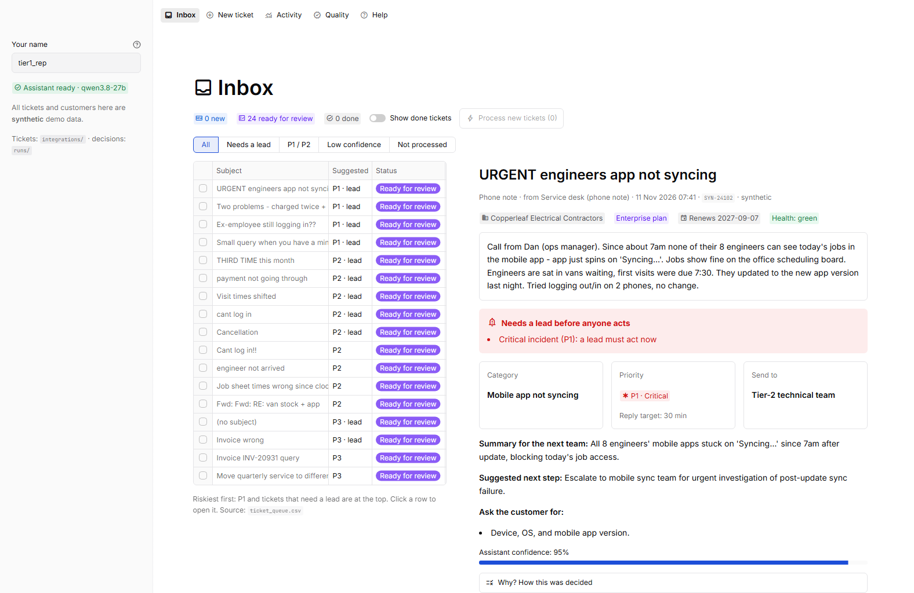
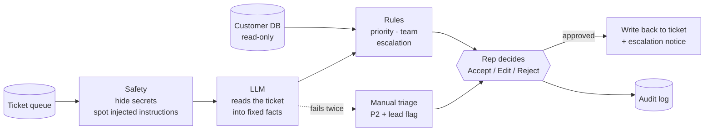
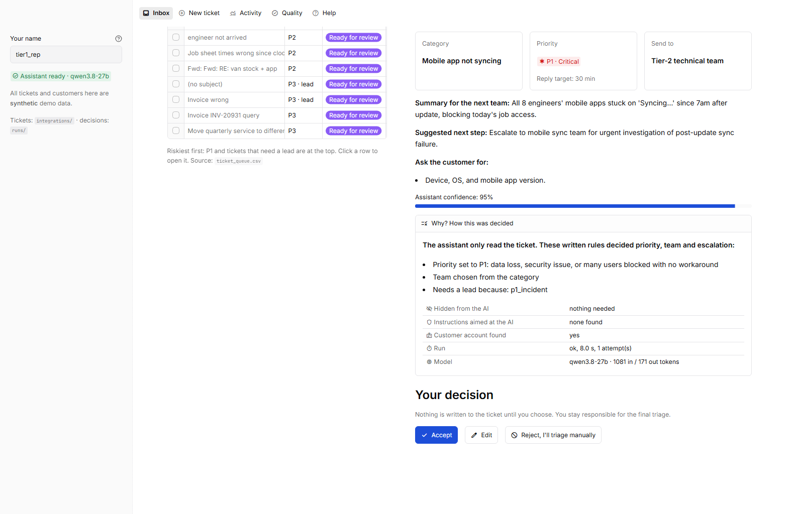
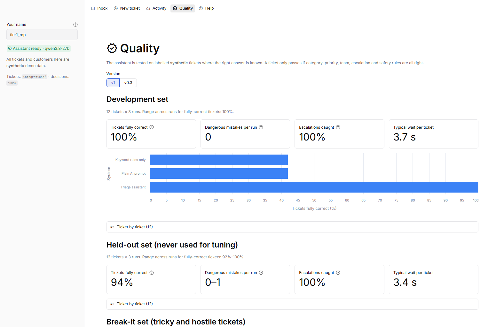

# Triage Desk: AI-assisted help desk triage with a human in charge

[](https://github.com/MYawar2712/AI-OS-mini/actions/workflows/tests.yml)

A working triage assistant for Tier-1 support at a B2B field-service software company, built in a 5-day AI workflow challenge. For every new ticket it pre-fills **category, priority, team, escalation and a handover note**. A support rep accepts, edits or rejects it, and only then is anything written to the ticket.

> **All data in this repo is synthetic.** No real customers, tickets or people. Every figure is labelled *measured* (on the synthetic test sets with the real model), *estimate*, or *assumed*.



## Results (measured)

34 labelled tickets in three groups, each run 3 times because the model's answers vary. Range across runs in brackets.

| | Everyday tickets (12) | Tickets written to break it (10) | **Held-out, never tuned on (12)** |
|---|---|---|---|
| **Tickets fully correct** | 100% | 100% | **94% (92–100%)** |
| Dangerous mistakes per run | 0 | 0 | 0–1 |
| Escalations caught | 100% | 100% | 100% |
| Median time per ticket | 3.7 s | 3.5 s | 3.4 s |
| *Keyword rules only, same tickets* | 42% | 0% | 0% |
| *Plain AI prompt, same tickets* | 42–58% | 50–60% | 33% |

The first two groups were used to find and fix failures, so the held-out column is the honest estimate. "Fully correct" means category, priority, team, escalation and every safety rule are right at once. Details: [before/after regression](docs/day4/02_regression.md) · [failure analysis](docs/day4/01_failure_analysis.md).

## How it works



- **The model only reads.** It turns the ticket into a fixed set of facts (who is affected, is work blocked, is a job hit today, data loss, security, churn threat…). Its output has no field for priority, team or escalation, so a ticket that tricks the model still cannot set them.
- **Written rules decide** priority, team and escalation. The "Why?" panel on every card lists the rules that fired.
- **Secrets never leave the machine.** Card numbers, passwords and API tokens are removed before the model call, the logs and the traces.
- **A person approves every ticket.** Nothing is written before that.
- **It fails to a person.** If the model fails twice, the ticket goes to manual triage as high priority; one failing ticket never stops the others.

Why this split: on Day 1, four models all read tickets well (92% category accuracy) but judged urgency badly (33–50% priority accuracy), while keyword rules missed two-thirds of escalations. They fail in opposite directions.



## Run it (Windows, about 10 minutes)

Needs Python 3.11+ ([python.org](https://www.python.org/downloads/), tick "Add Python to PATH") and an Alibaba Cloud Model Studio API key. In PowerShell, in this folder:

```powershell
powershell -ExecutionPolicy Bypass -File .\setup.ps1    # 1. install everything, create .env (paste your key when Notepad opens)
powershell -ExecutionPolicy Bypass -File .\run.ps1      # 2. open the Triage Desk in your browser
```

No key? It still runs: every ticket is sent to manual triage, which shows the fallback path.

<details>
<summary>Manual steps instead of the script</summary>

```powershell
python -m venv .venv; .venv\Scripts\python -m pip install -r requirements.txt
Copy-Item .env.example .env; notepad .env        # replace sk-REPLACE_ME with your key
.venv\Scripts\streamlit run app/review.py
```
</details>

### Using the Triage Desk
1. **Inbox → Process new tickets.** The assistant pre-fills every *New* ticket (about 30 s for the 24 sample tickets). Nothing is written yet.
2. **Open a ticket.** The riskiest are at the top. A **red box** means a lead must look before anyone acts. **Why?** shows how it was decided.
3. **Accept**, **Edit** or **Reject**.
4. The decision is written back to `data/integrations/ticket_queue.csv` (opens in Excel), leads get a notice when needed, and everything is listed under **Activity**. **Quality** shows the test results.

To add a ticket, use **New ticket**, or add a row with status `new` to the CSV. To start again, delete `data/integrations` and `data/runs`.

| If you see | Do this |
|---|---|
| "AI assistant key … not set" | Put the key in `.env`, restart |
| "The AI service did not respond" | The ticket went to manual triage. Try again in a minute |
| "Ticket file … is open in another program" | Close it in Excel, press the button again. Nothing was changed |
| "row(s) in the ticket file could not be read" | The message names the line and the fix |

## What's in the repo

| Read this | For |
|---|---|
| [docs/CASE_STUDY.md](docs/CASE_STUDY.md) | The whole project in one page: problem, design, results, failures, limits, next steps |
| [docs/day4/01_failure_analysis.md](docs/day4/01_failure_analysis.md) | Seven failures traced to root cause, and what changed |
| [docs/day2/01_system_design.md](docs/day2/01_system_design.md) | Architecture, data contracts, safety boundaries |
| [docs/RUNBOOK.md](docs/RUNBOOK.md) | Operating it: config, logs, what to do when something breaks, changing a rule safely |
| [docs/decisions.md](docs/decisions.md) | 33 decisions with alternatives and trade-offs |
| [docs/AI_COLLABORATION.md](docs/AI_COLLABORATION.md) | Which AI tools were used, for what, and how the results were checked |
| [docs/day5/02_rollout_metrics.md](docs/day5/02_rollout_metrics.md) | Metrics and gates for a two-week pilot |

| Code | What |
|---|---|
| `src/pipeline/` | `redact` → `injection` → `context` → `llm_extract` → `rules` → `run`; `batch` (trigger), `handoff` (the only writer) |
| `src/adapters/` | Integrations behind small interfaces: SQLite customer DB, CSV ticket queue (read + write-back), escalation notifier (file + optional Slack/Teams webhook) |
| `src/observability.py`, `src/preflight.py` | JSON logs with run IDs, plain-language errors, optional LangSmith tracing (redacted), startup checks |
| `app/` | Streamlit Triage Desk: Inbox, New ticket, Activity, Quality, Help |
| `config/` | `taxonomy.yaml` (categories, P1–P4 definitions, teams), `settings.yaml` (model, integrations). Secrets only in `.env` |
| `eval/` | 34 labelled test tickets (dev, held-out, break-it), scorer, all result files |
| `baselines/` | Keyword rules and a plain AI prompt, scored with the same scorer |
| `tests/` | 238 tests, no network or keys needed (fake model, temporary data) |

## For developers

```powershell
.venv\Scripts\python -m pytest                                                          # 238 tests
.venv\Scripts\python -m scripts.check_setup                                             # is everything in place?
.venv\Scripts\python -m scripts.process_queue                                           # the trigger without the UI
.venv\Scripts\python -m scripts.run_eval --label mine --sets dev,adversarial --runs 3   # quality + variance
.venv\Scripts\python -m scripts.langsmith_eval --sets dev,adversarial --label mine      # same, as LangSmith experiments
```

Model: `qwen3.8-27b` on Alibaba Cloud Model Studio, reasoning off, JSON output (chosen from four by a rule fixed in advance; [comparison](eval/results/model_comparison.md)). The provider is one setting in `config/settings.yaml`.



## Limits, stated plainly

- **No real support rep has used it yet.** Setup and wording were checked by an automated walkthrough only. Time saved and trust are unmeasured.
- **Synthetic tickets written by one person.** 34 tickets is a regression bar, not a statistical result.
- **Two held-out tickets still fail in 1 run of 3** (wrong category). Left unfixed on purpose so that set stays untuned.
- **Cost per ticket is not known:** about 1,060 tokens in and 160 out per ticket are measured; the model's price is not confirmed.
- **Not production-ready:** single-user local app, file-based queue, pattern-based redaction, third-party model host.
