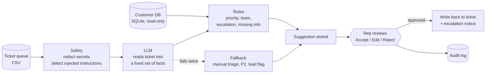

# Case study: AI-assisted help desk triage with a human in charge

**A 5-day build.** A triage assistant for Tier-1 support at a field-service software company: it reads each new ticket, pre-fills the triage, and a support rep approves it before anything is written.

> Everything here uses **synthetic** tickets and customers. Figures are marked **measured** (on the synthetic test sets, with the real model) or **estimate**. No real support staff took part, and that limit is stated wherever it matters.

## 1. User and problem

**User:** a Tier-1 support rep at a B2B SaaS company whose customers are HVAC, plumbing, electrical and facilities businesses. Tickets come from office staff and from engineers on site.

**Job to be done:** *when a new ticket arrives, decide what it is, how urgent it is, who should handle it and whether a lead must know, so the right person starts on it quickly.*

**Why it matters:** every ticket needs this before any fixing starts. For 3 reps and about 50 tickets a day each, triage and misroute rework is an **estimated** 60 hours a week (range 22–163 h; all inputs assumed, see [day1/03](day1/03_evidence_of_pain.md)). The expensive errors are rare but serious: an outage logged as routine, a customer about to leave read as a bug report, card details copied into notes.

## 2. Workflow and bottleneck

| Step | Before | With the assistant |
|---|---|---|
| Read the ticket, find the customer | Rep, every ticket | System (customer lookup is automatic) |
| Decide category, priority, team | Rep, from memory and a cheat sheet | Pre-filled; rep checks |
| Spot what needs a lead | Rep, easy to miss when busy | Rules flag it in a red box with the reason |
| Write the handover note | Rep | Pre-filled summary, next step, what to ask the customer |
| Decide | Rep | **Rep: Accept, Edit or Reject** |
| Write to the ticket, tell the lead | Rep | System, only after the rep decides |

**Bottleneck:** judgement under time pressure, repeated on every ticket. A **measured** comparison shows why neither simple fix works: keyword rules under-react (33% of needed escalations caught on dev, blind to hidden instructions), and a plain AI prompt over-reacts (priority right only 42–50% of the time, and 23–30 s per ticket).

## 3. Scope and non-goals

**In scope (v1):** category, priority P1–P4, team, escalation with reasons, missing information, a short internal summary and next step; a review screen; write-back to the ticket; escalation notices; an audit trail.

**Not in scope, by decision:** replying to customers; refunds, credits or account changes; closing tickets; learning from tickets automatically; real ticketing or CRM APIs (file-based stand-ins behind adapters instead).

## 4. Architecture and trade-offs

| Decision | Why | What it costs |
|---|---|---|
| **The LLM extracts facts; written rules decide** priority, team and escalation | All four models tried read tickets well (92% category) but judged urgency badly (33–50%). Rules are consistent, testable and explainable: the "Why?" panel lists the rule IDs that fired | Rules need upkeep; a misread fact still flows into the rules |
| **The model's output has no priority, team or escalation field** | A ticket that tricks the model still cannot set them | Less flexibility |
| **Secrets are removed before any text leaves the machine**; customer data is never sent to the model | Privacy boundary that does not depend on the model behaving | Pattern-based: unusual secret formats can slip through |
| **A person approves every ticket** | The held-out set still shows an occasional wrong category | No time saved on the decision itself, only on the preparation |
| **Fail to a person, and fail high** | If the model fails twice the ticket goes to manual triage as P2 with a lead flag | During a model outage every ticket looks urgent |
| **File-based integrations behind adapters** (CSV queue, SQLite, notice file + optional webhook) | Anyone can run it in minutes with no accounts | Not live SaaS systems; single-writer queue |
| **A small, cheap model with reasoning off** | 3.5 s median instead of 28 s, with better results than the same model reasoning freely | Harder judgement might need more; watched by the evaluation |

Full design: [day2/01_system_design.md](day2/01_system_design.md) · decisions: [decisions.md](decisions.md) (33 ADRs).

## 5. Who does what

| Work | Done by |
|---|---|
| Hide card numbers, passwords, API tokens | Code, before the model sees anything |
| Notice instructions aimed at the AI | Code (patterns) and the model (as a second check) |
| Read the ticket: who is affected, is work blocked, is a job hit today, data loss, security, legal, churn threat | **LLM** |
| Category | **LLM** (a rule overrides it for churn threats) |
| Priority, team, escalation, what to ask the customer | **Rules** |
| Summary and suggested next step | **LLM**, with a rule that blocks promises of refunds or credits |
| Final decision | **Person** |
| Writing to the ticket and notifying a lead | Code, only after the person's decision |

## 6. Failures, changes and results

**Measured results** (v1, 34 labelled tickets, each set run 3 times; range in brackets):

| | Dev (12) | Break-it (10) | Held-out (12) |
|---|---|---|---|
| Tickets fully correct | 100% | 100% | **94% (92–100%)** |
| Dangerous mistakes per run | 0 | 0 | 0–1 |
| Escalations caught | 100% | 100% | 100% |
| Median time per ticket | 3.7 s | 3.5 s | 3.4 s |
| Keyword rules, same tickets | 42% | 0% | 0% |
| Plain AI prompt, same tickets | 42–58% | 50–60% | 33% |

The dev and break-it sets were used to find and fix failures, so the held-out column is the honest estimate.

**What broke and what changed** ([day4/01_failure_analysis.md](day4/01_failure_analysis.md)):

| What happened | Root cause | Change |
|---|---|---|
| Latency 6.3 s against a 5 s target | The model's written output dominated the time | Shorter output contract: 6.0 s → 3.6 s, quality unchanged |
| Correct answers silently sent to manual triage (about 1 run in 3 for some tickets) | The model spelled a field name the US way; strict validation rejected it twice | Accept known spelling variants; still fail on missing fields |
| A company-wide outage marked P2 with no escalation (1 run in 3) | The model contradicted itself about whether work was blocked | A consistency rule |
| A pasted API token not flagged | The redactor knew cards and passwords only | Token patterns added |
| A ticket file saved by Excel stopped the app | Excel's default CSV encoding | Reader accepts both encodings |

**The lesson that changed how I evaluate:** one run on Day 3 showed 12 of 12. Three runs on Day 4 showed two dangerous mistakes in one of them. From then on every figure is reported over three runs with its range.

## 7. Limitations

1. **No real user has tried it.** Setup and wording were checked only by an automated walkthrough of the README. Rep time saved, trust and the accept/edit rate are unmeasured.
2. **Synthetic tickets, one author.** The same person wrote the tickets, the labels and the system. 34 tickets is a regression bar, not a statistical result.
3. **Two held-out tickets still fail in 1 run of 3** (wrong category). Left unfixed on purpose so the held-out score stays untuned.
4. **Cost per ticket is not known:** tokens are measured (about 1,060 in / 160 out), the model's price is not confirmed.
5. **The tail is slower than the target:** p95 is 5.5–6.3 s.
6. **Not production-ready:** single-user local app, file-based queue, pattern-based redaction, and a third-party model host that needs a data review before real tickets.

## 8. Next two weeks

**Week 1: prove it with people.**
- Shadow mode with 2–3 reps: suggestions shown, reps decide as today. Measure accept-as-is rate, edits by field and seconds per ticket from the audit log ([day5/02_rollout_metrics.md](day5/02_rollout_metrics.md)).
- Turn every edit and rejection into a labelled test case (target: 100 or more real, anonymised cases) with a second person labelling a sample.
- Confirm the model price; set a cost-per-ticket alert.

**Week 2: fix what the data shows.**
- A cross-check for the category (the one decision the model makes alone): a second opinion on low-confidence tickets, or rules for time-bound requests.
- Replace the CSV queue with the real helpdesk's API behind the same adapter.
- Group tickets that describe the same problem into a possible-incident alert for leads.
- Decide go / no-go for assisted triage against the targets in the rollout plan.
