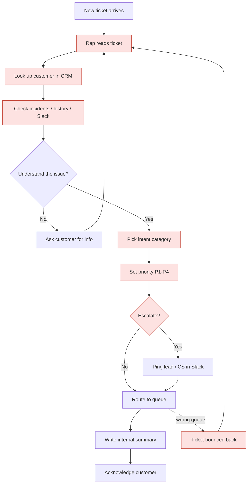
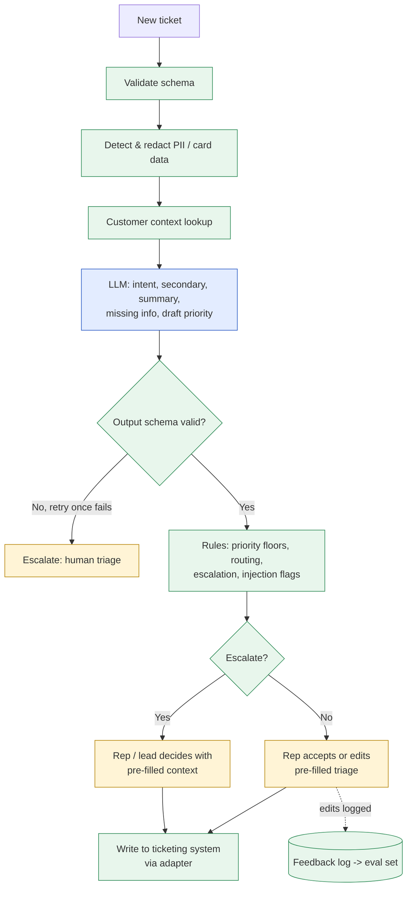

# 02: Workflow map

> Current state is a **proxy** reconstruction (no shadowing session yet). Validate with interview Q1 ([01](01_user_and_jtbd.md)).

## Current state: manual triage, step by step

| # | Step | Trigger | Input | Judgment required | Tool used | Approval needed | Output | Exceptions |
|---|---|---|---|---|---|---|---|---|
| 1 | Pick up ticket | New ticket in shared queue | Ticket list | Low: which one next (usually oldest first, so urgent ones can wait) | Ticketing system | No | Ticket opened | Morning spike: 30+ unread |
| 2 | Read & understand | Ticket opened | Subject, body, forwarded thread, attachments | **High**: what is actually wrong; multi-issue; tone | Ticketing system | No | Mental model of issue | Vague text, mixed language, long threads, pasted PII |
| 3 | Identify customer | Need account context | Sender email, signature | Medium: match sender to account | CRM | No | Account ID, plan, renewal date, health | Unknown sender, personal email, reseller |
| 4 | Check context | Account found | Open incidents, recent tickets, status page | Medium: "is this a known issue / repeat?" | CRM, ticket history, status page, Slack | No | Linked incident or "new" | Info spread across 3–4 tools |
| 5 | Classify intent | Understood issue | Steps 2–4 | **High**: pick a category (often 1 of ~10) | Ticketing system field | No | Category | Multi-intent: rep picks one, the other gets lost |
| 6 | Set priority | Intent known | Impact, urgency words, account tier | **High**: P1–P4. Definitions are applied inconsistently | Ticketing system field | No (P1 is told to lead afterwards) | Priority | Angry tone over-prioritised; calm description of outage under-prioritised |
| 7 | Decide escalation | Priority + context | Churn hints, legal/security words, P1 | **High**: does a lead / CS need to know now? | Slack/Teams, ticketing | Sometimes (lead for P1, CS for churn) | Escalation note or none | Churn signal buried in a bug report |
| 8 | Route | Intent + priority | Queue rules (cheat sheet) | Medium | Ticketing system assign | No | Assigned queue/engineer | Wrong queue leads to a bounce (rework, delay) |
| 9 | Write summary | Before handoff | Everything above | Medium: what does the next team need? | Ticketing internal note | No | Internal note | Skipped under time pressure, so the next team re-reads everything |
| 10 | Acknowledge / ask for info | Routed | Template replies | Medium: what is missing? | Ticketing macros | No | Customer reply | Asking twice; asking for card details by mistake |

## Current state: flowchart

_Red = steps that carry most of the time and error cost._

## Future state (v1): AI-assisted triage with a human in the loop

| Step | Owner in v1 | How |
|---|---|---|
| Ticket intake + validation | **Deterministic** | `InboundTicket` schema; reject or flag malformed payloads |
| PII/card detection & redaction | **Deterministic** | Regex/Luhn check before any LLM call; sets `sensitive_data_present` |
| Customer lookup & context | **Deterministic** (integration #1) | Customer ID → plan, renewal, health, open incidents |
| Intent, secondary intent, summary, missing info, draft priority | **AI-assisted** | LLM with schema-enforced structured output, taxonomy definitions, context |
| Priority floor / modifiers, routing, escalation rules | **Deterministic rules** | `taxonomy.yaml` rules can only *raise* priority or *add* escalations, never lower them |
| Injection detection | **Deterministic + AI** | Pattern rules plus the LLM flag; either one triggers escalation |
| Output validation | **Deterministic** | `TriageResult` schema; invalid → retry once → fall back to "escalate: human triage" |
| Accept / edit triage | **Human** | Rep reviews the pre-filled triage; one click to accept, or edit (edits logged for the learning loop) |
| Escalation decisions, customer replies, refunds, account changes | **Human** | Never automated in v1 |

_Blue = AI-assisted, green = deterministic, yellow = human._

## The single bottleneck we will solve: **first-touch triage (steps 2–9)**

Scope: **intent + priority + routing + escalation decision + structured summary** for one ticket, with a human accepting the result.

| Factor | Evidence (see [03](03_evidence_of_pain.md)) |
|---|---|
| **Frequency** | Every ticket passes through it: ~750 tickets/week, base estimate (A-02, A-03). |
| **Time** | ~3 min each, about 37.5 h/week of pure triage, plus ~22.5 h/week of misroute rework (estimate). |
| **Error cost** | Misroutes add an estimated ~3 h to the customer's wait. Under-prioritised P1s mean whole field teams idle. Missed churn signals mean lost revenue. Measured on the synthetic set: the cheat-sheet baseline caught only **33% of must-escalate cases**. |

**Why this one, and not something else:**
- *Auto-replying* has a higher blast radius (customer-facing) and depends on triage being right first.
- *Resolution* (fixing the issue) differs by intent, so it can't be done in 5 days.
- Triage is upstream of everything else, so improving it improves SLA, routing and reporting at once.
