# 01: System design (v0)

> Scope: AI-assisted **first-touch triage** for Tier-1 support (intent, priority, routing, escalation, summary). All data is **synthetic**.
> v0 = working end-to-end flow with a human approval step. Integrations become real adapters on Day 3.

## 1. Architecture: the LLM reads, rules decide, a human approves

The core idea (ADR-017): the model is used **only for reading comprehension**. It turns messy ticket text into a fixed set of facts. **Policy is deterministic code:** priority, team, escalation, what may be suggested. A human approves before anything is written.

Why: on Day 1 every model tested over-prioritised (priority 33–50% correct) and over-escalated, while reading accurately (intent 92%). So the job is split along those strengths.

```mermaid
flowchart LR
    subgraph IN[Input]
        T[Inbound ticket JSON<br/>email / portal / chat / phone note]
    end
    subgraph DET1[Deterministic safety layer]
        V[1 Validate<br/>InboundTicket schema]:::rule
        R[2 Redact secrets<br/>card, CVV, expiry, password]:::rule
        I[3 Injection detector<br/>8 patterns]:::rule
        C[4 Customer lookup<br/>read-only CRM]:::rule
    end
    subgraph AI[AI step]
        L[5 LLM fact extraction<br/>strict JSON, redacted text only]:::ai
        S{6 Valid ExtractedFacts?<br/>1 retry}:::rule
    end
    subgraph DET2[Deterministic policy]
        P[7 Rules: intent tie-breaks, P1–P4,<br/>queue, escalation, missing info,<br/>action guard]:::rule
        A[8 Assemble TriageResult<br/>+ re-redact model text]:::rule
    end
    subgraph HUM[Human]
        H{Rep reviews card<br/>accept / edit / reject}:::human
    end
    subgraph OUT[Outputs]
        O[(Ticketing outbox<br/>fields + internal note)]
        AU[(Audit log<br/>trace + decision)]
    end
    T --> V --> R --> I --> C --> L --> S
    S -- yes --> P --> A --> H
    S -- no, twice --> F[Fallback: valid result,<br/>escalate to human triage]:::rule --> H
    H -- accept/edit --> O
    H --> AU
    classDef ai fill:#e3ecff,stroke:#2c5cc5;
    classDef rule fill:#e8f6ec,stroke:#2e8b57;
    classDef human fill:#fff4d6,stroke:#b8860b;
```

_Blue = AI, green = deterministic code, yellow = human._

## 2. End-to-end data flow

| # | Step | Code | Input | Output | Typical time |
|---|---|---|---|---|---|
| 1 | Validate | `run.py` | raw JSON | `InboundTicket` (or rejected) | < 1 ms |
| 2 | Redact | `pipeline/redact.py` | subject + body | redacted text + kinds found | < 1 ms |
| 3 | Injection check | `pipeline/injection.py` | original text | matched pattern names | < 1 ms |
| 4 | Customer lookup | `pipeline/context.py` | `customer_id` | account record or none | < 1 ms |
| 5 | LLM extraction | `pipeline/llm_extract.py` | **redacted** ticket only | `ExtractedFacts` JSON | ~5–10 s (measured) |
| 6 | Validate + retry | `pipeline/llm_extract.py` | model text | valid facts, or failure after 2 attempts | in step 5 |
| 7 | Rules | `pipeline/rules.py` | facts + flags + account | intent, priority, queue, reasons, missing info, safe action | < 1 ms |
| 8 | Assemble | `run.py` | all above | `TriageResult` + `PipelineTrace` | < 1 ms |
| 9 | Human review | `scripts/triage.py` | triage card | `ReviewDecision` | rep time |
| 10 | Write | `pipeline/handoff.py` | result + decision | outbox record + audit record | < 5 ms |

Measured on the v0 demo: all deterministic steps together **< 2 ms**; the LLM call is the whole latency budget.

## 3. Schemas and data contracts

All contracts are Pydantic v2 models in [`src/schemas.py`](../../src/schemas.py) with `extra="forbid"`. JSON Schemas are exported to [`schemas/`](../../schemas). Enums are tested against [`config/taxonomy.yaml`](../../config/taxonomy.yaml).

| Contract | Direction | Purpose | Key guarantees |
|---|---|---|---|
| `InboundTicket` | in | Ticket from the ticketing system | required subject/body/channel; `customer_id` may be null; `synthetic=true` |
| `ExtractedFacts` | LLM → code | **The only thing the LLM may produce.** 16 facts + summary, action, confidence | No priority/queue/escalation fields exist, so the model *cannot* set them |
| `TriageResult` | out | Final triage | escalate ⇔ reasons; enums only; secondary ≠ primary |
| `PipelineTrace` | audit | Step timings, tokens, retries, redactions, injection matches, rules fired, facts | Contains **redacted** text only |
| `ReviewDecision` | human → code | accepted / edited / rejected + edited fields + seconds to decide | Required before any write |
| `OutboxRecord` | out | What is written to the ticket: fields + internal note + the review | Internal fields only, never a customer reply |

Contract between steps 5 and 7 (why facts, not labels): a rule like *"core workflow blocked + many users + no workaround → P1"* is auditable and testable. "The model said P1" is not.

## 4. Model, tool, storage and interface choices

| Choice | Decision | Rationale | Alternatives considered |
|---|---|---|---|
| **Model** | `qwen3.8-27b` on Alibaba Cloud Model Studio (Intl), **reasoning off**, JSON mode, max 700 tokens | Won the pre-registered 4-model comparison (ADR-016). Reasoning off cut latency from 28 s to ~6.5 s median with no quality loss on dev/held-out. JSON mode removes free-text parsing. | `deepseek-v4.1-flash` (fallback, faster); Anthropic models (configurable) |
| **LLM role** | Fact extraction only | Models read well (92% intent) but judge priority badly (33–50%) | LLM sets priority with rules on top (rejected: rules could only raise, not fix over-prioritisation) |
| **Tools** | None given to the model. No function calling, no web, no write access | Removes the main prompt-injection blast radius: a fooled model can only produce wrong *facts*, which rules and humans check | Agent with ticketing tools (rejected for v1) |
| **Rules engine** | Plain Python reading `taxonomy.yaml` | Readable, unit-tested (each rule has an ID in the trace), no extra dependency | Rules DSL / decision tables (overkill for ~15 rules) |
| **Storage** | Append-only JSONL: `data/runs/audit.jsonl`, `data/runs/ticketing_outbox.jsonl` (git-ignored) | Zero setup, human-readable, easy to replay into the eval set (Day 4 learning loop) | SQLite (Day 3+ if querying is needed); a DB (not needed for v0) |
| **Interface (v0)** | CLI: `python -m scripts.triage --case TC02` prints a plain-language triage card; reviewer types a/e/r | Fastest way to prove the full flow including the approval step | Streamlit/Sheets review screen (Day 5, non-developer UX) |
| **Integrations** | v0 mocks: CRM = JSON file, ticketing = outbox file | Same function boundaries the Day 3 adapters will implement | Live Zendesk/Freshdesk (non-goal for v1) |
| **Config/secrets** | `config/*.yaml` + `.env` (git-ignored) | One place to switch model/provider, prices, thresholds | n/a |

## 5. Human approval points, fallbacks, permission boundaries

### 5.1 Human approval points
| # | Where | Who | What they decide |
|---|---|---|---|
| H1 | **Every** ticket, after the triage card is shown | Tier-1 rep | accept / edit (intent, priority, queue, escalate) / reject → manual triage. **Nothing is written without this.** |
| H2 | `escalate = true` | Lead (or CS for churn) | Acts on the listed reasons. The system never resolves an escalation |
| H3 | Injection or sensitive-data flags | Rep | Confirms the redaction is sufficient and the request is genuine |
| H4 | Changes to `taxonomy.yaml` (rules) | Support manager | Versioned in git; re-run the eval before merging |

### 5.2 Fallbacks and failure handling
| Failure | Detection | Behaviour |
|---|---|---|
| Malformed inbound payload | `InboundTicket` validation | Rejected before any processing |
| LLM returns non-JSON or schema-invalid JSON | Pydantic validation | 1 retry with the error message; then **fallback** |
| LLM timeout / API error / no API key | `LLMCallError` / `LLMNotConfigured` | SDK retries (2); then **fallback** |
| **Fallback result** | n/a | A *valid* `TriageResult`: general_inquiry / P3 / tier1, `escalate=true` with `low_confidence` plus any deterministic flags (missing account, injection, sensitive data). The ticket is never lost and never silently mis-triaged |
| Model under-reports a risk | Deterministic detectors run independently | Injection, secrets, unknown account and legal keywords escalate regardless of the model |
| Model proposes refund/discount/credit | `rules.safe_action` | Action replaced with "needs human with authority" (rule R-ACT) |
| Model echoes a secret in its summary | Re-redaction of model text | Secret replaced before display/storage |
| Reviewer enters an invalid edit | `TriageResult` re-validation | Edit refused; nothing written |

### 5.3 Permission boundaries
| The system CAN | The system CANNOT (by construction) |
|---|---|
| Read the inbound ticket | Send anything to a customer (no reply channel exists in code) |
| Read customer context (read-only) | Change accounts, plans, payments, refunds, credits |
| Call the LLM with **redacted** ticket text | Give the LLM tools, web access, or customer CRM data |
| Write ticket **fields + internal note** to the outbox, **after** human approval | Write without a `ReviewDecision` |
| Append to the audit log | Delete or edit audit records (append-only) |

## 6. Privacy
| Data | Where it goes | Control |
|---|---|---|
| Card numbers, CVV, expiry, passwords | **Never leave our process** | Redacted before the LLM call (Luhn-checked cards); model output re-redacted; audit stores redacted text only |
| Ticket text (redacted), sender name/email | Alibaba Cloud Model Studio (Singapore) | Needed for triage. Synthetic in this repo; **data residency and the provider's retention terms must be reviewed before real tickets** |
| Customer account context | Local only | Used by rules; **not sent to the LLM** (data minimisation) |
| Audit / outbox | `data/runs/` locally, git-ignored | Append-only; retention policy to be set before production |
| API keys | `.env` only | git-ignored; `.env.example` has placeholders |

Not yet covered (documented gaps): email/phone masking toward the LLM; secrets the regexes don't recognise (e.g. API tokens); retention and deletion policy.

## 7. Evaluation rubric and pass/fail criteria

The rubric is unchanged from Day 1: [`eval/rubric.md`](../../eval/rubric.md) (case PASS needs all critical fields; P1/P2 under-prioritisation, missed must-escalate and must-not violations are critical).

**v0 gates** (scored with `python -m scripts.run_day2 --holdout`):

| Gate | Criterion | Dev (12) | **Held-out (12)** | Status |
|---|---|---|---|---|
| End-to-end flow | One ticket goes input → approval → outbox + audit | demo transcript | n/a | ✅ PASS |
| G3 Schema validity | 100% valid outputs | 100% | 100% | ✅ PASS |
| G1 Escalation recall | 100% of must-escalate cases | 100% | 100% | ✅ PASS |
| G2 Under-prioritisation | 0 P1/P2 rated lower | 0 | 0 | ✅ PASS |
| G4 Injection | injection cases pass | PASS | PASS | ✅ PASS |
| G5 Must-not violations | 0 | 0 | 0 | ✅ PASS |
| G6 Case pass rate | ≥ 83% | 100% | **92%** (11/12) | ✅ PASS |
| G7 Routing accuracy | ≥ 92% | 100% | 92% | ✅ PASS |
| G8 Escalation precision | ≥ 75% | 100% | 100% | ✅ PASS |
| G9 Median latency | < 5 s | 6.5 s | 6.3 s | ❌ FAIL: next fix (§8) |
| G10 Cost per ticket | < $0.002 | TBC | TBC | ⏳ price not confirmed |

**Caveats.**
- The dev set was visible while the prompt and rules were written, so its 100% is optimistic. The **held-out score (11/12) is the headline**.
- n = 12 per set, single runs: one case = 8.3 points.
- A dev re-run moved priority exact accuracy from 92% to 83%, which shows run-to-run variation.

## 8. Known limitations and next steps
| Limitation | Plan |
|---|---|
| Latency 6.3–6.5 s median (gate < 5 s), all in the LLM call | Day 3: shorten the output (drop rationale, cap summary), then try `deepseek-v4.1-flash` with reasoning off (0.7 s on a short probe) under the same eval |
| Held-out miss TC19 (seat quote read as general inquiry) | Not tuned on (held-out discipline). Logged for Day 4 error analysis together with new cases |
| Injection detector is pattern-based | Combined with the model flag. Add adversarial cases on Day 4 |
| CLI review only | Day 5 non-developer review screen |
| Mock CRM and ticketing | Day 3 adapters (customer context + ticketing/CSV) |
